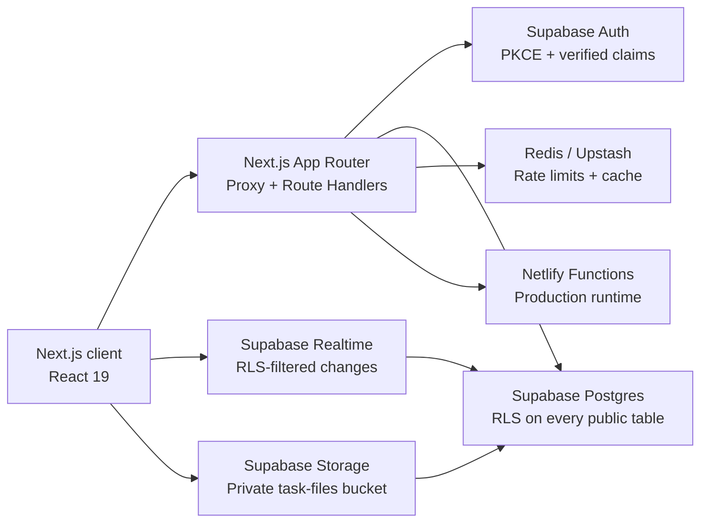
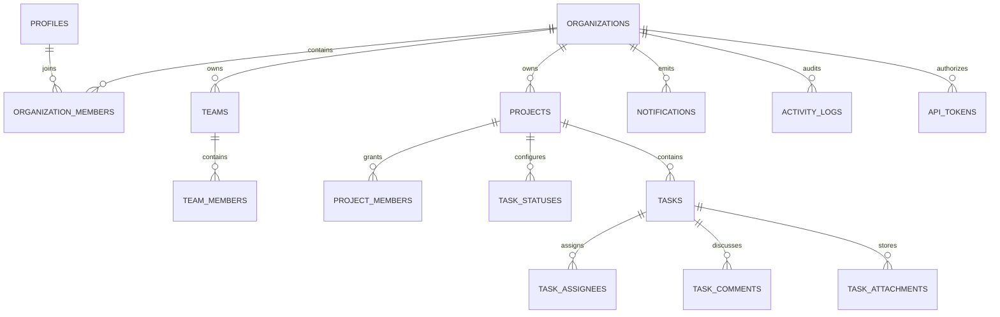

<div align="center">

# Dynamis Flow

### Work moves better when everyone sees the path.

A multi-tenant project operations platform for teams that plan, ship, and learn together.

[Live product demo](https://dynamis-flow.netlify.app) · [API reference](#api) · [Architecture](#architecture) · [Local setup](#local-development)


</div>

---

## Overview

Dynamis Flow is a portfolio-grade SaaS project management product inspired by the clarity of Linear, the flexibility of Monday and ClickUp, and the approachability of Trello.

It is designed around a simple product belief: project software should help a team understand the work, not create more work to manage the software.

The repository contains two complementary experiences:

- A polished, public product site that explains the Dynamis point of view.
- An interactive application workspace with dashboard, board, calendar, activity, notifications, task details, comments, and task creation.

The deployed demo runs without credentials, so reviewers can explore it immediately. The same codebase contains production-ready Supabase authentication, multi-tenant database design, Row Level Security, private file storage, Realtime foundations, a versioned API, and optional Redis rate limiting.

## Product tour

Open the [interactive workspace](https://dynamis-flow.netlify.app/workspace) and try the following:

1. Switch between **Overview**, **Board**, **Calendar**, and **Activity**.
2. Open a task from the priority table or Kanban board.
3. Change its status and add a comment.
4. Drag a task between Kanban columns.
5. Create a new task.
6. Open the global search and notifications inbox.
7. Resize the browser to see the responsive workspace.

Demo interactions intentionally use in-memory state. Configure Supabase and set `NEXT_PUBLIC_DEMO_MODE=false` to use the persistent backend.

## Feature coverage

| Capability | What is included |
| --- | --- |
| Authentication | Email/password sign-up and sign-in, PKCE callback, SSR cookie refresh, verified server claims |
| Organizations | Tenant model, organization profiles, membership, owner/admin/member/guest roles |
| Teams | Team directory, team membership, project ownership |
| Projects | Project metadata, keys, privacy, dates, archive state, project-level membership |
| Tasks | Status, priority, hierarchy, estimates, dates, assignees, ordering, archive and completion |
| Kanban | Four workflow columns, native drag-and-drop, task counts and rich task cards |
| Calendar | Responsive month view with due-date task placement |
| Comments | Thread-ready schema, interactive comments, edit/delete authorization |
| File uploads | Private `task-files` bucket, 50 MB limit, MIME allowlist, tenant-scoped Storage policies |
| Notifications | Personal inbox, read state, assignment/mention/comment/status event types |
| Activity logs | Append-oriented organization audit model and product activity timeline |
| Roles and permissions | Organization roles plus private-project editor access enforced in PostgreSQL |
| API | Versioned `/api/v1/tasks` endpoint with verified auth and optional Redis rate limiting |
| Realtime | RLS-filtered publication for tasks, comments, notifications, and activity |
| Operations | Docker image, Redis service, CI workflow, Netlify configuration, environment template |

## Architecture



### Request lifecycle

1. `proxy.ts` refreshes the Supabase auth cookie when credentials are configured.
2. Server handlers validate the JWT signature through `supabase.auth.getClaims()`.
3. PostgreSQL receives the authenticated user identity.
4. RLS evaluates organization and project access for every query.
5. Redis applies a per-client rate window when Upstash credentials are available.
6. The handler returns only rows permitted by the caller's database policies.

Authorization is enforced in the database, not inferred from hidden buttons in the interface.

## Data model



The initial migration lives at [`supabase/migrations/202607270001_initial_platform.sql`](supabase/migrations/202607270001_initial_platform.sql).

### Permission model

| Action | Owner | Admin | Member | Guest |
| --- | :---: | :---: | :---: | :---: |
| View organization projects | ✓ | ✓ | ✓ | ✓ |
| Create projects and tasks | ✓ | ✓ | ✓ | Scoped |
| Manage teams and members | ✓ | ✓ | — | — |
| Update organization settings | ✓ | ✓ | — | — |
| Access private projects | ✓ | ✓ | If added | If added |
| Edit a private project | ✓ | ✓ | If editor | If editor |
| Manage API tokens | ✓ | ✓ | — | — |
| Delete projects | ✓ | ✓ | — | — |

Project access is refined by `project_members.can_edit`. Private projects require an explicit membership unless the user is an organization owner/admin or project creator.

## Security design

The database migration applies the following controls:

- RLS is enabled on every table exposed through the public schema.
- Policies target the `authenticated` PostgreSQL role explicitly.
- Authorization helpers live in a non-exposed `private` schema.
- `SECURITY DEFINER` helpers use an empty search path and have narrow execute grants.
- User-controlled metadata is not trusted for roles or tenant authorization.
- Organization relationship columns used in policies are indexed.
- Data API privileges are explicit and remain constrained by RLS.
- Anonymous database access is revoked.
- Storage objects are private and tenant-scoped by the first path segment.
- API tokens store a hash and display prefix, never the raw credential.
- The browser only receives a modern Supabase publishable key. A service-role key is never used by the client.
- Security headers deny framing, MIME sniffing, camera, microphone, and geolocation.

For responsible disclosure, see [SECURITY.md](SECURITY.md).

## Technology

### Product layer

- Next.js 16 App Router
- React 19
- TypeScript in strict mode
- Tailwind CSS 4 plus a bespoke Dynamis design system
- Lucide iconography

### Platform layer

- Supabase Auth for identity and session management
- PostgreSQL for relational multi-tenant data
- Supabase RLS for authorization
- Supabase Storage for private task attachments
- Supabase Realtime for collaborative events
- Redis / Upstash for rate limiting and cache-ready infrastructure
- Docker and Docker Compose for reproducible local operation
- Netlify for Next.js hosting, functions, and CDN

## Repository structure

```text
dynamis-flow/
├── .github/
│   └── workflows/ci.yml        # typecheck, lint, and production build
├── src/
│   ├── app/
│   │   ├── api/v1/tasks/       # versioned REST endpoint
│   │   ├── auth/callback/      # Supabase PKCE callback
│   │   ├── login/              # authentication experience
│   │   ├── workspace/          # interactive product workspace
│   │   ├── globals.css         # Dynamis visual system
│   │   └── page.tsx            # product marketing site
│   ├── components/
│   │   └── workspace-shell.tsx
│   ├── data/
│   │   └── demo.ts             # deterministic preview fixtures
│   └── lib/
│       ├── rate-limit.ts
│       └── supabase/
├── supabase/
│   ├── config.toml
│   └── migrations/
├── Dockerfile
├── docker-compose.yml
├── netlify.toml
└── package.json
```

## Local development

### Requirements

- Node.js 22 or newer
- pnpm 10
- A Supabase project for live mode
- An Upstash Redis database for production rate limiting (optional)
- Docker Desktop if using containers (optional)

### 1. Clone and install

```bash
git clone https://github.com/eemirex/dynamis-flow.git
cd dynamis-flow
corepack enable
pnpm install
```

### 2. Configure the environment

```bash
cp .env.example .env.local
```

For a zero-configuration preview, leave:

```env
NEXT_PUBLIC_DEMO_MODE=true
```

For a live Supabase environment:

```env
NEXT_PUBLIC_SUPABASE_URL=https://your-project.supabase.co
NEXT_PUBLIC_SUPABASE_PUBLISHABLE_KEY=sb_publishable_your_key
NEXT_PUBLIC_DEMO_MODE=false
NEXT_PUBLIC_APP_URL=http://localhost:3000
```

Optional Upstash variables:

```env
UPSTASH_REDIS_REST_URL=https://...
UPSTASH_REDIS_REST_TOKEN=...
```

### 3. Start the application

```bash
pnpm dev
```

Visit [http://localhost:3000](http://localhost:3000).

## Supabase setup

The checked-in migration is the source of truth for the remote schema.

Using the Supabase CLI:

```bash
supabase login
supabase link --project-ref YOUR_PROJECT_REF
supabase db push
```

Then configure these authentication URLs in the Supabase dashboard:

- Site URL: your production deployment URL
- Redirect URL: `https://your-domain.example/auth/callback`
- Local redirect URL: `http://localhost:3000/auth/callback`

The migration creates the private `task-files` Storage bucket. Upload paths must follow:

```text
{organization_id}/{task_id}/{unique_filename}
```

This convention is part of the Storage RLS boundary.

## Docker

The container setup runs Next.js and a persistent Redis 7 service:

```bash
cp .env.example .env.local
docker compose up --build
```

The app is available on port `3000`; Redis is exposed on port `6379`.

The Docker image uses Node 22 Alpine, installs dependencies in a separate stage, builds the optimized Next.js output, and runs as an unprivileged `nextjs` user.

## API

### List tasks

```http
GET /api/v1/tasks
Authorization: Bearer <supabase-access-token>
```

Demo response:

```json
{
  "data": [
    {
      "id": "MOB-18",
      "title": "Build guided onboarding flow",
      "status": "In progress",
      "priority": "Urgent"
    }
  ],
  "meta": {
    "mode": "demo",
    "rateLimitRemaining": 60
  }
}
```

### Create a task

```http
POST /api/v1/tasks
Content-Type: application/json
Authorization: Bearer <supabase-access-token>

{
  "projectId": "uuid",
  "statusId": "uuid",
  "title": "Prepare release checklist",
  "description": "Confirm owners and go/no-go criteria.",
  "priority": "high"
}
```

Writes return `403` in demo mode. In live mode the handler verifies the session and PostgreSQL RLS performs the final authorization check.

### Rate limiting

When Upstash is configured, requests use a fixed one-minute Redis window with a 60-request allowance per forwarded client address. Without Redis credentials, the endpoint remains usable and reports rate limiting as disabled internally.

## Quality checks

```bash
pnpm typecheck
pnpm lint
pnpm build
```

The project has been verified against:

- Strict TypeScript compilation
- ESLint with the Next.js Core Web Vitals rules
- Next.js production compilation
- Desktop landing-page rendering
- Desktop workspace rendering
- Mobile workspace rendering at 390 × 844
- Task creation and modal interaction
- Browser console warning/error inspection

## Deployment

### Netlify

The public portfolio deploy uses a credential-free static export so every reviewer can explore it without backend access. The checked-in `netlify.toml` pins Node 22, enables demo mode, and publishes the generated `out` directory.

1. Import the GitHub repository into Netlify.
2. Add the environment variables from `.env.example`.
3. Keep `NEXT_PUBLIC_DEMO_MODE=true` for a public portfolio demo, or set it to `false` after connecting Supabase.
4. Deploy the `main` branch.

For a live production workspace, remove `NETLIFY_STATIC_EXPORT`, restore the normal `pnpm build` command and `.next` publish target, then provide Supabase credentials. Netlify's Next.js runtime will package route handlers as Functions and proxy logic for the edge.

### Production readiness checklist

- [ ] Apply the Supabase migration.
- [ ] Add production and preview callback URLs to Supabase Auth.
- [ ] Configure a modern `sb_publishable_...` key.
- [ ] Configure Upstash Redis.
- [ ] Set `NEXT_PUBLIC_DEMO_MODE=false`.
- [ ] Run Supabase Security and Performance Advisors.
- [ ] Protect the GitHub `main` branch and require the CI workflow.
- [ ] Configure a custom domain and monitoring.

## Product decisions

### Why a separate demo mode?

A portfolio reviewer should not need credentials, seed steps, or access to a paid backend to understand the product. Demo mode provides immediate, deterministic exploration while keeping the real integration boundaries visible and testable.

### Why PostgreSQL RLS?

Tenant security should survive a UI bug and an incomplete API filter. RLS makes organization and project access a database invariant shared by server routes, Realtime, and direct Supabase queries.

### Why Redis if PostgreSQL is already present?

Short-lived operational state such as rate windows and cache entries has different access and expiration patterns from durable project records. Redis keeps that load out of the relational model.

### Why a bespoke interface instead of a UI template?

The Dynamis system is intentionally quieter than a typical generated dashboard. Its spacing, typography, color, task density, empty states, interaction copy, and marketing narrative were designed as one product language.

## Roadmap

- Persist the interactive workspace through Supabase queries and mutations
- Add presence, typing indicators, and optimistic Realtime updates
- Add workload and capacity planning
- Add saved filters and custom project views
- Add webhook subscriptions and scoped API token middleware
- Add task dependencies and release milestones
- Add email and push notification workers
- Add full-text search with PostgreSQL `tsvector`
- Add organization billing and usage limits
- Add Playwright end-to-end coverage

## Contributing

Issues and focused pull requests are welcome. Please read [CONTRIBUTING.md](CONTRIBUTING.md) before proposing a change.

## License

Released under the [MIT License](LICENSE).

---

<div align="center">
Built with care under the <strong>Dynamis</strong> brand.
</div>
